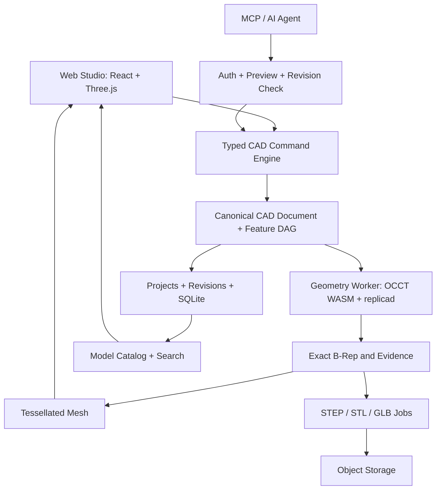

# Web CAD × 3D Model Store × AI Agent — 系统蓝图

> **版本**：v1.0 · **调研基准**：2026-11-17 · **状态**：规划与可执行命令引擎概念验证（**不是完整 CAD 产品**）

## CAD-006 草图约束求解（v1.4）

- 基于 `@salusoft89/planegcs@1.3.0` 的**真实 2D WASM 求解器**，在独立浏览器 Worker 运行；支持点/线/圆和水平、垂直、距离、重合、半径子集。
- 草图实验页：`npm install && npm run dev:studio`，访问 `/sketch.html`；完全约束 120×60 矩形转换成等价精确 OCCT Box 并可导出 STEP。
- 欠约束、冲突、残差过大时 fail closed，保留最后有效实体。**本阶段不支持任意曲线的通用 Extrude，也不代表完成 P0 G0/P2 G2。**
- [CAD-006 详细技术文档](docs/27-cad-006-planegcs-sketch-worker.md) / [ADR-0004](docs/adr/0004-planegcs-dedicated-worker-and-limited-profile.md)
- 测试：`npm run test:sketch-unit`；真实 WASM：`npm run test:sketch-wasm`；浏览器：`npm run test:sketch-browser`。

## CAD-004 浏览器 WASM Worker 实现（v1.3 候选）

> `occt-wasm@5.17.2` 真正运行在 Dedicated Worker 内，并提供独立 Node WASM 与 Chromium 浏览器测试，最终通过状态以 GitHub CI 为准。**不代表完整 P0 G0 通过，Solver、Safari/Firefox 与 100-cycle 仍待验证。**

- [实现说明与复现命令](docs/26-browser-occt-wasm-worker-spike.md) / [ADR-0003](docs/adr/0003-occt-wasm-single-thread-worker.md)
- 内核：`packages/cad-geometry/src/{evaluator,worker-runtime,browser-worker,node-worker,client}.mjs`
- 浏览器 Studio：`npm install && npm run dev:studio`（http://127.0.0.1:4173），Box/Cylinder/Boolean、参数修改、STEP 下载与 Three.js 渲染。
- 无网络本地测试：`npm test && npm run test:worker-unit`；联网真实内核：`npm run test:wasm && npm run test:browser`。

## CAD-004 / CAD-005 最新实现

- [OCCT native B-Rep / STEP round-trip 实测记录](docs/19-cad-004-005-evidence.md)
- [Geometry Python 参考内核与复现命令](packages/cad-geometry-python/README.md)
- [技术决策 ADR-0001](docs/adr/0001-native-occt-reference-then-wasm.md)
- [真实 STEP 示例](samples/precision-block.step) 与 [几何证据](samples/precision-block.evidence.json)

**历史状态（v1.1）：** 当时仅使用原生 OCCT 完成几何构建、校验与 STEP 往返；v1.3 已新增浏览器 Worker 实现，验收范围以 `docs/26` 与 CI 为准。


## 最新实现进展｜v1.2 Contract + Native Geometry + Catalog Hardening

> **代码修复已在本地执行，但浏览器 WASM Worker、真实 Studio、API 鉴权和 P1 完整 Gallery 仍未完成。** P0 G0 / P1 G1 / P2 G2 均尚未放行。

- **P0 JS/native 合同**：提供 Schema v1 生成器（Document/Transaction/GeometryEvidence/WorkerEnvelope）、显式 `outputBodyId`、确定性 DAG 依赖排序，以及长度参数引用；16 组跨语言 solid fixtures 一致。
- **真实参数重建与 STEP**：`node scripts/create_parameter_revision.mjs` 生成孔径 12mm 的 revision 2；原生 OCCT 使用改动的参数产生有效 B-Rep，并导出及独立回读 [`samples/precision-block-r6.step`](samples/precision-block-r6.step)。
- **P1 数据安全**：SQLite `002_immutable_publications.sql` 新增 staging/published 发布状态、已发布资产清单/资产的不可变触发器；catalog service 生成并固定 manifest SHA。中文搜索目前是**受限的子串扫描回退**（非正式中文分词），10k 合成数据基准仅用于可行性估计。
- **已运行的测试**：17 项 Node、18 项 native Python、6 项 SQLite catalog，Schema parity 16 组；新增 CI 作业及检查脚本。
- [v1.2 实施证据、限制与下一步](docs/25-implementation-evidence-contract-store.md)。

### 快速复验

```bash
npm run check
python -m pip install -e 'packages/cad-geometry-python[test]'
python scripts/check_contract_parity.py
npm run test:geometry
node scripts/create_parameter_revision.mjs > /tmp/r6.cad.json
PYTHONPATH=packages/cad-geometry-python/src python -m cad_geometry.cli run /tmp/r6.cad.json \
  --step /tmp/r6.step --report /tmp/r6.evidence.json
python scripts/benchmark_catalog_search.py
```

## 下一阶段工程 Review 与 P0–P2 计划（2026-11-17）

> **历史 Review 基线**为 12 项 JS / 11 项 Python。上述阻塞项已在 native/contract/SQLite 参考实现中部分修复；浏览器 Worker、真实 API、Studio 仍是未完成的阶段任务。详情参阅 v1.2 证据文档。

- [20｜工程级 Review 与缺口](docs/20-deep-review-and-gaps.md)：已复现问题、风险与优先级。
- [21｜下一阶段 P0–P2 核心里程碑](docs/21-next-milestones-p0-p2.md)：M0–M6、G0/G1/G2、依赖、排期与验收。
- [22｜Contract Freeze 与测试矩阵](docs/22-contract-freeze-and-verification.md)：文档/Worker/Kernel/STEP 的一致性协议。
- [23｜P1 Model Library 实施设计](docs/23-model-store-p1-plan.md)：Release 不可变性、中文搜索、资产校验、ACL、Gallery。
- [24｜P2 Parametric Studio 实施设计](docs/24-parametric-studio-p2-plan.md)：草图约束、特征树、参数化重建、恢复和导出。
- [下一阶段任务拆解 CSV](planning/p0-p2-next-backlog.csv)：按 Gate 与依赖排序。

**优先推进 Schema/执行语义收敛，再实现真正的浏览器 WASM Worker，而不是直接扩展 UI。** 原有 P0–P6 目录是阶段蓝图，更新后的 Go/No-Go 以 [21](docs/21-next-milestones-p0-p2.md) 为准。

## 项目目标

构建以 **精确 B-Rep CAD + 参数化历史** 为底座、以 **3D 模型资产市场** 为入口、以 **标准化导出** 和 **MCP Agent** 为扩展的 Web CAD 平台。

**核心约束**：一个 Canonical CAD Document，一条 Typed Command Engine 操作通道，人类和 Agent 都要经过相同的校验、预览、修订版本检查和提交；Three.js Mesh 不是设计事实来源。

## 阅读路线（系列文档）

| 顺序 | 文档 | 核心回答 |
| --- | --- | --- |
| 00 | [产品范围与成功指标](docs/00-product-charter.md) | 做什么、不做什么、谁使用、怎样验收 |
| 01 | [技术调研与选型](docs/01-research-and-selection.md) | 开源技术与许可证、关键决策 |
| 02 | [用户旅程与功能设计](docs/02-product-flows.md) | 商店、CAD、导入导出、AI 四个闭环 |
| 03 | [系统架构](docs/03-system-architecture.md) | 前端、内核、命令引擎、存储、服务边界 |
| 04 | [仓库结构与代码分层](docs/04-monorepo-layout.md) | Monorepo 如何拆包、接口怎么定 |
| 05 | [CAD 文档与命令契约](docs/05-cad-domain-and-commands.md) | 特征、参数、修订、拓扑、原子事务 |
| 06 | [几何内核与约束求解](docs/06-geometry-and-sketch.md) | B-Rep/WASM/草图约束/重建 |
| 07 | [模型商店设计](docs/07-model-store.md) | 模型质量等级、搜索、版本、权利管理 |
| 08 | [数据库与存储](docs/08-database-and-storage.md) | SQLite Schema、索引、资产策略 |
| 09 | [REST API 与文件导出](docs/09-api-and-import-export.md) | 端点、转换流程、可验证导出 |
| 10 | [AI CAD / MCP 设计](docs/10-mcp-agent.md) | 2026-07-28 MCP、授权/预览/提交 |
| 11 | [Web UI/UX 设计规范](docs/11-ui-ux.md) | 专业工作台、交互状态机、可访问性 |
| 12 | [路线图与任务拆分](docs/12-roadmap-and-backlog.md) | P0–P6、Epic、依赖、DoD |
| 13 | [测试与质量门禁](docs/13-testing-and-acceptance.md) | 几何证据、回归、CI、安全 |
| 14 | [部署与运维](docs/14-deployment-and-operations.md) | Pages 限制、静态/动态分离、SLO |
| 15 | [架构决策 ADR](docs/adr/README.md) | 为什么这样设计、替代选项 |
| 16 | [Agent 开发工作流](docs/16-agent-engineering-workflows.md) | 多 Agent 协作任务、审计与贡献规则 |
| 17 | [首月 Sprint 计划](docs/17-first-month-plan.md) | 前四周可以直接执行什么 |
| 18 | [来源与核验清单](docs/18-references.md) | 官方文档和开源项目证据 |

## 设计系统（高层）



## 仓库状态与可验证范围

- `packages/cad-core/`：**可运行**的最小 JavaScript 命令引擎，演示 revision、输入验证、依赖 DAG、原子事务和摘要；**不包含** CAD 几何计算。
- `packages/cad-geometry/`：TypeScript 旧设计接口仍保留，但真实浏览器 `browser-worker.mjs` 和 `client.mjs` 已实现 P0 子集。`Sketch/Extrude` 等仍未实现。
- `packages/cad-contracts/`：设计层的跨端类型及 JSON Schema 示例。
- `packages/cad-store/migrations/001_init.sql`：可在 SQLite 执行的初始数据结构，含模型全文搜索 FTS5。
- `packages/cad-mcp/contracts/`：MCP 工具契约草案；**非**可运行的 MCP Server。
- `apps/studio/`：新增真实 WASM Worker + Three.js 的最小 P0 演示（非完整 CAD 编辑器）；`apps/api/` 仍为占位说明。

### 本地验证

```bash
npm test                  # 无第三方依赖：验证命令引擎
python3 scripts/verify_blueprint.py   # 文档链接、SQLite 迁移与样例校验
```

> 不要将本包中的概念性命令引擎误认为具备真正草图求解、B-Rep、STEP 导出、模型商店登录或 MCP 网络服务。那些能力在各阶段实现并经独立验收后才能声明完成。

## 核心阶段

| 阶段 | 最小可交付结果 | 阶段门禁 |
| --- | --- | --- |
| P0 架构 Spike | 关键库验证、统一协议、可量化基准 | 真实 OCCT WASM 建模并验证体积/文件 |
| P1 Model Store | 分类检索、预览、下载、复制引用 | 元数据与对象文件完整性一致 |
| P2 CAD MVP | 草图约束、拉伸、切割、参数重建 | 几何回归 + 保存重开 + 撤销重做 |
| P3 Formats | STEP/STL/GLB 的导出与质量校验 | Round-trip 与格式校验通过 |
| P4 Engineering | 装配、BOM、工程图 | 装配关系与版本引用可重建 |
| P5 AI/MCP | 查询、预览、授权提交、导出 | 权限绕过/过期 revision 攻击被拒绝 |
| P6 Platform | 团队权限、云计算、审计、商业化 | SLO、安全评估与实际用户验证 |

## 特别说明

- GitHub Pages 仅用于非商业性质的静态演示/文档，不作为电商或 SaaS 正式生产服务（GitHub Pages 使用政策见 `docs/14-deployment-and-operations.md`）。
- 商业发布前必须完成依赖许可证、模型授权、第三方资源与出口格式支持范围的核验。
- **已完成**：研究、设计文档、命令层最小可执行示例和测试；**尚未完成**：CAD 产品、真实网页界面、云 API 与 MCP 服务器。

## GitHub Issue 与 AI 工程协作

- `planning/backlog.csv`：按 P0–P6 编号的 Issue 清单（可转换成 GitHub Issues/Projects 数据）。
- `.codex/skills/web-cad-engineering/SKILL.md`、`.pi/skills/web-cad-engineering/SKILL.md`、`.claude/skills/web-cad-engineering/SKILL.md`：相同的研发 Agent 工作规范模板。
- `AGENTS.md`：跨代理统一门禁与事实声明规范。

这些 Skill 是**本项目的开发规范**，不是能直接完成 CAD 建模的生产 MCP 工具。


## CAD-007 · 精确多边形 Profile Spike（下一阶段）

- [详细实现与验收边界](docs/28-cad-007-profile-history-lifecycle.md)；[ADR-0005](docs/adr/0005-planar-wire-face-extrusion.md)。
- 在原 `/sketch.html` CAD-006 矩形演示之外，新增 `/profile.html`，支持真实 planegcs Worker、单闭环折线、OCCT `Wire → Face → Extrude`、STEP 下载和单机本地 Undo/Redo。
- 三角形、旋转矩形、凹 L 形保留几何形状；不对曲线、洞、断开轮廓和自相交线条静默转换为包围盒。
- `npm run test:profile-unit`、`npm run test:profile-wasm`、`npm run test:profile-browser` 对应纯代码/真实 WASM/Chromium-Firefox-WebKit 分层验证。
- 100 次生命周期测试不是严格的 WASM 堆泄漏证明，WebKit/Linux 也不是 macOS Safari 真机认证。
