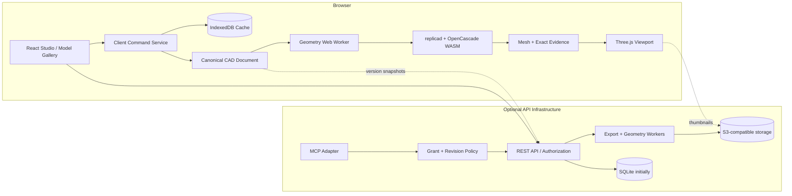

# 03｜系统架构：一份文档、多种界面、两个运行环境

## 3.1 逻辑组件

## 3.2 每层职责与禁止依赖

| 层 | 负责 | 不应负责 |
| --- | --- | --- |
| `apps/studio` | 页面、工具状态机、相机、属性 UI | 隐式修改内核实体、持久存储业务规则 |
| `cad-contracts` | DTO、Schema、错误码、格式定义 | React、Three、SQLite |
| `cad-core` | 命令校验、参数/特征 DAG、revision、Undo/Redo | 渲染、底层精确曲面算法 |
| `cad-geometry` | B-Rep 操作、约束求解、网格生成、测量 | 账号、支付、审批 |
| `cad-store` | 项目模型 catalog、revision、许可、资产位置 | 几何变形、浮点实体演算 |
| `cad-api` | 身份、项目授权、任务调度、公开 API | 直接执行不经领域层的模型编辑 |
| `cad-mcp` | MCP 传输、工具注册、输入规范化 | 生成另一份不同的 CAD 数据模型 |

**合法方向**：UI/API/MCP → CommandService → Document → GeometryAdapter → Artifacts，持久化层经 repository 接口调用。

## 3.3 浏览器与云端两条路线

**Local-first（P0–P2）**：不登录即可绘制、本地保存、下载。浏览器 Worker 运行 WASM；WebGL 渲染网格。无网络不应丢失本地草稿。

**Cloud (P3–P6)**：项目成员、公开模型发布、共享文件、受控导出与 headless Agent 需要 API + 对象存储；几何计算从浏览器 Worker 移到同一内核适配接口的后端 Worker，要求一致的 kernel version 与相同的几何验证标准。

两者**不能**为同一文档在不同版本的内核上无声计算；保存记录至少 `schemaVersion`, `kernelVersion`, `solverVersion`, `documentRevision`, `artifactHash`。

## 3.4 增量重建流程

1. 客户端收到带 `expectedRevision` 的命令事务，执行输入校验和权限校验。
2. 在 detached 副本上修改文档，构建 feature DAG、验证唯一 ID 和依赖存在性。
3. 计算受影响节点的下游闭包；按拓扑顺序调用 KernelAdapter。
4. 计算精确实体及 health evidence（validity、closed、bodyCount、volume、bbox、warnings）。
5. 只有全部需要的检查成功才允许提交新 revision；mesh 结果从已提交的实体重新生成。
6. 将文档快照及 manifest 原子保存；昂贵网格与 preview 可按版本和质量等级缓存。

**注意**：本包附带的 `cad-core` 示例只实现了 1–2 中部分*文档层*行为，不包含 3–6 的真正几何实现。

## 3.5 长任务与失败容错

- 浏览器端使用 Worker 请求 ID + generation token，防止旧结果覆盖新文档；使用 AbortSignal 及 Worker terminate 作为粗粒度取消。
- 云端转换任务实现 `queued → running → validating → completed | failed | cancelled`，支持 retry、超时、资源配额和幂等键。
- Blob 按内容哈希命名并附带 `sha256`, bytes, mime, format, kernelVersion, sourceRevision, createdAt。
- 事务冲突不自动重放随机几何更改；要求 AI/用户重新读取文档并预览。
- 对 WASM 内存生命周期、B-Rep dispose/delete 实施显式约束和长时会话压测。

## 3.6 边界条件

- 底层长度统一用 mm；所有 UI 单位转换必须在输入/展示边界。
- 精确容差由内核和操作决定，不能把前端网格离散精度当作公差；测试语料明确阈值。
- Feature logical ID 稳定，但单个 `TopoDS_Face` 不是天然稳定 ID；必须在重建结果中映射/识别并报告歧义。
- STL 无材质/特征历史；GLB 更偏渲染；STEP 几何可交换不代表原生编辑历史。

## 3.7 后续扩容

P1 可用 SQLite FTS5 做目录搜索；写入并发增长时将数据库 repository 迁移 PostgreSQL。几何计算独立 Worker 池；队列和对象存储可分别扩展；所有 API 仍使用同一领域 Schema。不要在初期引入微服务泛滥。
