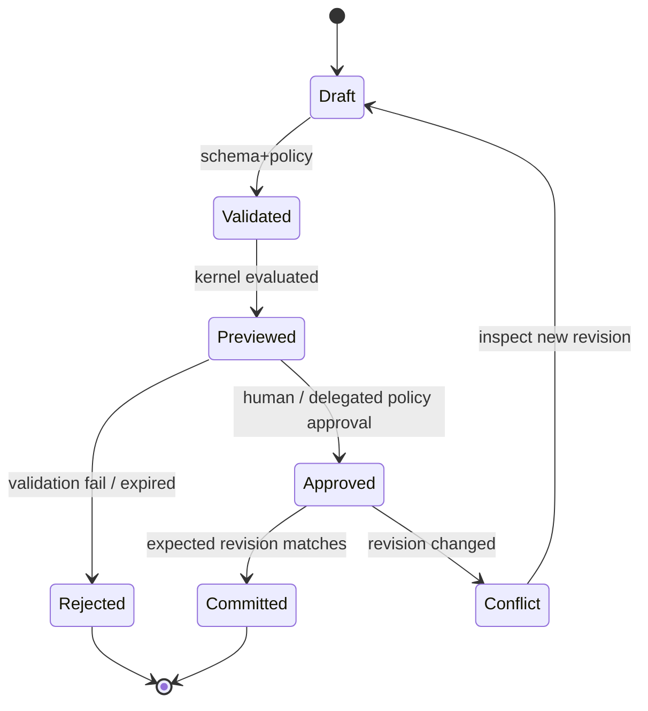

# 05｜Canonical CAD Document、特征 DAG 与 Typed Commands

## 5.1 文档对象

```ts
type CadDocument = {
  schemaVersion: 1;
  documentId: string;
  revision: number;                  // integer monotonic, starts at 0
  units: 'mm';                       // internals are always mm
  parameters: Record<string, {kind: 'length'|'angle'|'count', value: number}>;
  features: CadFeature[];            // unique logical ids; valid DAG
  assemblies: AssemblyDefinition[];  // P4
  metadata: {title: string; kernelVersion?: string; solverVersion?: string};
};
```

每次提交都应记录 `actorId`, `revision`, `parentRevision`, `commandLog`, `documentHash`, `kernelVersion`, `createdAt`。**文档修订**与**几何计算产物**分别版本化。

## 5.2 Feature 标识与引用

- 使用稳定逻辑 ID：`sketch-001`, `extrude-001`；禁止使用 JS 数组索引作为持续引用。
- `Sketch` 描述草图平面、实体与约束；`Extrude` 引用闭合 profile；`Boolean` 引用两个有效 body。
- 特征之间形成有向无环图；依赖缺失、重复 ID、循环和非法顺序必须在提交前拒绝。
- `FaceRef`、`EdgeRef` 是逻辑持久引用：包括创建特征、几何签名、方向、邻接信息；不能直接等同 `TopoDS_Face` 下标。

## 5.3 命令接口

```ts
type CadCommand =
  | {op:'parameter.set'; name:string; kind:'length'|'angle'|'count'; value:number}
  | {op:'feature.add'; feature:CadFeature}
  | {op:'feature.update'; id:string; patch:Partial<EditableFeatureFields>}
  | {op:'feature.remove'; id:string};

type CadTransaction = {
  transactionId: string;            // UUID, for dedupe and audit
  expectedRevision: number;
  commands: CadCommand[];
};
```

实际代码入口优先使用 zod/JSON Schema 校验，按命令细分白名单，不允许 `eval`、表达式中的任意函数调用或业务层直接注入 OCCT 类型。

## 5.4 原子预览 / 提交协议

- **Preview**：在原文档的副本上执行所有命令，求解约束，构建精确实体，输出 `candidateDocumentHash`, `geometryEvidence`, `previewId`, `baseRevision` 和错误集合；不会覆盖主文档。
- **Commit**：验证 preview 未过期、actor 授权、操作预算与 `expectedRevision`；新 revision 原子写入元数据与 revision manifest。
- **Conflict**：即使看起来没有视觉变化，baseRevision 已变也返回 `REVISION_CONFLICT`，不能静默 rebase。
- **Idempotency**：同一 `transactionId` 在同一文档上重复发送返回相同结果；不同命令体复用 ID 返回 `IDEMPOTENCY_CONFLICT`。

### 状态机



## 5.5 参数与单位系统

- 内部 mm、rad、无量纲 count；UI 可显示英寸与角度，但边界转换必须明确。
- 参数表达式采用 AST 白名单：变量、数值常量、加减乘除、允许的数学函数；**禁止 JS `eval`**。
- 表达式解析同时执行单位量纲检查，例如长度不能直接赋给角度；除零/NaN/Inf 拒绝。
- 公差由几何内核上下文控制，容差不是 UI 小数位；每一项回归 fixture 记录精度阈值。

## 5.6 Undo/Redo 与协作基础

- Undo/Redo 建议采取 immutable snapshots + typed inverse commands，`revision` 是服务端提交递增编号，撤销也应生成新 revision，而不是“回退全局计数”。
- 同步冲突时不允许 UI 私自覆盖服务端 revision；本地草稿与远端正式历史明确分离。
- 重放命令必须锁定 schema/kernel 兼容版本，避免引擎升级后无声改变几何。

## 5.7 内核证据契约

```json
{
  "documentRevision": 12,
  "kernelVersion": "<pinned-version>",
  "status": "valid",
  "bodyCount": 1,
  "solidCount": 1,
  "volumeMm3": 213000,
  "bboxMm": [0, 0, 0, 120, 60, 30],
  "closedShells": true,
  "warnings": [],
  "topologySignature": "sha256:<digest>",
  "meshArtifactId": "asset:<sha256>"
}
```

上面是**示例结构**，体积为占位示例，不代表任何样例已真实测量。最终发布不能仅凭这个 JSON 声称有效，必须由真实 CAD 内核得出并验证。

## 5.8 本包参考实现

见 `packages/cad-core/src/command-engine.mjs` 与 `packages/cad-core/test/command-engine.test.mjs`。它实现文档级别事务和依赖检查，**未实现** preview 的几何求解和生产数据库提交。
