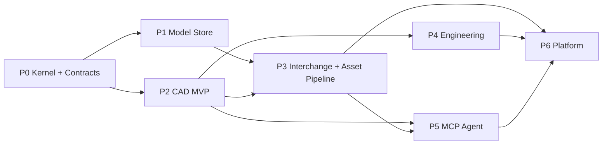

# 12｜P0–P6 Roadmap、Epic 拆解与门禁

> 工期为**规划估算**，不是承诺；按 2–4 名熟悉 TS/前端/几何内核的工程师作粗略估计，单人一般更长。需求优先级和实现方式可随 Spike 结果调整。

> **2026-11-17 Review 更新：**本页是 P0–P6 的长期阶段目录，不代表当前可用功能。`CAD-004` 的 native oracle 已完成、浏览器 Worker 未实现；`CAD-005` 仅通过单实体 STEP Spike。详细阻断项见 [工程 Review](20-deep-review-and-gaps.md)，修订后的可执行计划见 [P0–P2 下一阶段里程碑](21-next-milestones-p0-p2.md)。当前应优先修复 R-01/R-02/R-03/R-05，再做浏览器 WASM。

## 12.1 依赖图



> CAD-004 已完成原生 OCCT 参考实现但 WASM 未完成；CAD-005 的基础 STEP 往返 Spike 已通过。详见 [本地验证记录](19-cad-004-005-evidence.md)。

## 12.2 P0 — 架构验证（2–3 周）

| ID | 子任务 | 依赖 | 验收 |
| --- | --- | --- | --- |
| CAD-001 | 技术与许可证矩阵定稿 | 无 | 记录版本、许可证、复制限制和替代方案 |
| CAD-002 | Canonical Document v1 + JSON Schema | CAD-001 | schema 验证、版本兼容、示例测试 |
| CAD-003 | CommandEngine：事务、revision、DAG | CAD-002 | 原子失败、过期 revision、循环依赖单测 |
| CAD-004 | OCC Worker 初始化与基础实体 | CAD-001 | 真实 B-Rep 有效；非截图证明 |
| CAD-005 | STEP round-trip 技术 Spike | CAD-004 | 重新导入后体积、bbox、solid count 按阈值一致 |
| CAD-006 | planegcs/草图求解器试验 | CAD-001 | 欠/全/过约束样例与诊断结果 |
| CAD-007 | 浏览器可用性/内存基准 | CAD-004 | 记录设备、WASM 包大小、初始化时间、100 次构建内存 |
| CAD-008 | P0 ADR 和风险评审 | 001–007 | go/no-go 决策与变更记录 |

**P0 Gate（修订）**：跨运行时 Schema/执行语义一致 + 浏览器实际 WASM Worker 精确几何 + STEP 独立回读 + Solver Spike + 生命周期证据 + 版本/许可证审核同时通过，方可宣布 P0。原生 OCCT 的成功**不能替代浏览器验收**。完整条件见 [21](21-next-milestones-p0-p2.md) 与 [22](22-contract-freeze-and-verification.md)。

## 12.3 P1 — 模型商店（3–5 周）

| ID | 子任务 | 依赖 | 验收 |
| --- | --- | --- | --- |
| STORE-001 | SQLite 元数据表与迁移 | CAD-002 | FK、FTS5、索引测试 |
| STORE-002 | Object Storage manifest 和签名下载 | STORE-001 | hash 一致且私有文件不能公开读取 |
| STORE-003 | 浏览/搜索/分类/分页 UI | STORE-001 | 10k 记录分页可用；中文查询召回和 FTS 语义可测 |
| STORE-004 | Three.js GLB 查看器 | CAD-001 | 相机、拾取、错误状态、内存释放 |
| STORE-005 | 模型详情/release/权限 | 002–004 | 显示许可、能力等级、格式 |
| STORE-006 | Copy Reference/Open in Studio | STORE-005 | 引用固定 release，准确生成 ref |
| STORE-007 | 上传/发布基础流水线 | 001–006 | 授权与文件校验，发布不可变 |

**P1 Gate（修订）**：通过不可变 release membership/下载 ACL/中文检索/真实 GLB Viewer/资产 hash 证据，完成“检索→预览→复制固定引用→下载”闭环；`Open in Studio` 到 P2 验收，不宣称是付费商店。详见 [23](23-model-store-p1-plan.md)。

## 12.4 P2 — 参数化 CAD MVP（6–10 周）

| ID | 子任务 | 依赖 | 验收 |
| --- | --- | --- | --- |
| CAD-101 | Studio App shell/command palette/shortcut | CAD-003 | 状态机与 Escape/Undo 测试 |
| CAD-102 | 2D Sketch entities + snapping | CAD-006 | 精确坐标与端点吸附 |
| CAD-103 | Constraint Solver integration | 102 | 欠/全/过约束，残差与冲突诊断 |
| CAD-104 | Extrude / Cut / Union | CAD-004, 103 | 有效 B-Rep、bbox/volume 测试 |
| CAD-105 | Feature DAG + parameter updates | CAD-003, 104 | 上游改动只重建受影响节点 |
| CAD-106 | Face/Edge pick identity | 104 | 重建后歧义引用不误选 |
| CAD-107 | Autosave + local recovery | CAD-002,105 | 刷新关闭/恢复不丢失完整文档 |
| CAD-108 | CAD E2E fixture | 101–107 | 画→约束→拉伸→改参数→重开→P0 狭义 STEP 导出 |

**P2 Gate（修订）**：精确零件不是装饰性 mesh；真实草图尺寸和特征历史可修改、保存、恢复、增量重建，并由 P0 STEP 子集导出回读。P3 负责扩充格式能力。详见 [24](24-parametric-studio-p2-plan.md)。

## 12.5 P3 — 文件交换（4–6 周）

| ID | 子任务 | 依赖 | 验收 |
| --- | --- | --- | --- |
| IO-001 | 格式能力 Registry/提示 | CAD-005 | 非无损转换明确警告 |
| IO-002 | STEP import/export | CAD-005, CAD-105 | round-trip 精确证据 |
| IO-003 | STL/GLB 导出 | CAD-104 | 网格/GLB schema 检查 |
| IO-004 | Conversion jobs + cancellation | STORE-002 | 限流/状态机/重试/幂等 |
| IO-005 | Asset lineage + revision manifest | IO-002–004 | 每个产物可追溯 sourceRevision |
| IO-006 | 格式回归集 | IO-002–005 | 失败样本不可假成功 |

## 12.6 P4 — 装配与工程图（6–10 周）

| ID | 子任务 | 验收 |
| --- | --- | --- |
| ENG-001 | PartDefinition / Occurrence schema | 固定 release + 唯一 instance ID |
| ENG-002 | 装配坐标与基本约束 | 无循环、变换和约束关系可重建 |
| ENG-003 | BOM 与部件版本引用 | 数量、名称、release 一致 |
| ENG-004 | 正交投影和基本标注 | 投影与精确实体来源一致 |
| ENG-005 | SVG/PDF/DXF 子集输出 | 标注、比例、版式与边界测试 |

## 12.7 P5 — MCP Agent（5–8 周）

| ID | 子任务 | 验收 |
| --- | --- | --- |
| AGENT-001 | 受控 CommandService REST API | AI 与 UI 使用相同校验器 |
| AGENT-002 | MCP read-only / capabilities | 同时检查 2026 与可兼容旧客户端 |
| AGENT-003 | Detached Preview | 主文档不变且证据可审阅 |
| AGENT-004 | Approval Gate + revision CAS | 无授权、stale、重放均失败 |
| AGENT-005 | 导出任务与 MCP job 查询 | 产物 manifest 与 revision 一致 |
| AGENT-006 | Audit + security fuzz + rate limits | 0 未授权成功提交，所有变更可追踪 |

## 12.8 P6 — 平台化与商业能力（按需求）

TEAM-001 团队权限；TEAM-002 多租户隔离；TEAM-003 云端 geometry worker 扩容；TEAM-004 协作版本与冲突解决；MARKET-001 付费模型/授权；OBS-001 SLO 与事件响应；LEGAL-001 商标与模型许可流程。是否做付费交易由市场验证决定，不能将其默认纳入 MVP。

## 12.9 Issue 模板

```md
## Goal / 用户价值
## Scope / 非目标
## Inputs and Typed Contracts
## Architecture boundary
## Geometry/Data/Security risk
## Acceptance Criteria (Given/When/Then)
## Tests / Verification evidence
## Dependencies / Blocking issues
## Rollback and recovery
```

## 12.10 全阶段完成定义（DoD）

一项能力完成至少满足：Schema 与版本处理、成功路径、失败路径、自动化测试、对用户的可观测反馈、权限检查、适当的性能基准、文档更新；几何相关项目还需**内核测量/有效性证据**。
