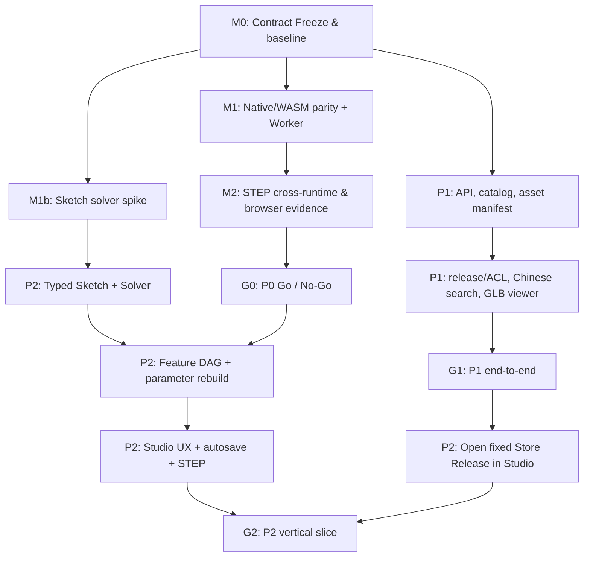

# 21｜下一阶段 P0 → P1 → P2：核心里程碑、依赖、资源与 Go/No-Go

> **状态**：可执行计划，不是已交付代码。基线 `2026-11-17`，2–4 名有 TS/Browser/CAD 经验工程师的粗估；实际迭代以技术 Spike 数据重新标定，不承诺日期。原 P0–P6 仍是**产品阶段**，本计划中的 `G0/G1/G2` 是验收门禁。

## 0. 目标、范围与最终演示

### 产品目标

用户可以先在 Model Library 发现**带真实许可证和固定版本引用**的零件（P1），再在 Web Studio 中**从强类型草图通过约束创建真实 B-Rep 零件**，修改尺寸后重建并导出 STEP（P2）。

### 唯一纵向验收案例

一块 120×60×30 mm 板件，在中心用直径 8 mm 的圆孔贯穿：

1. Browser Worker 启动 OCCT WASM，构建有效 B-Rep，与 native oracle 一致。
2. Browser 导出 STEP，通过另一独立 Reader 读回，核验真实实体（不是仅显示网格）。
3. P1 将其作为 `PARAMETRIC_NATIVE` 的固定 Release 发布；检索、GLB 预览、授权下载 STEP、复制稳定版本引用。
4. P2 在工作台中通过受约束草图和拉伸/切割构建同等实体；改孔径为 12 mm，体积随参数变化并可 Undo/Redo，保存重开，导出 STEP。

P1 的上传/发布不依赖 P2 完成，可先使用**受控 seed / CLI 上传**的已验证样例；`Open in Studio` 是 P2 集成验收，不能阻挡 P1 自身上线。

### 非目标（这三个阶段均不做）

商业支付、公开付费商店、装配约束、工程图/GD&T、协同实时编辑、工业级全量 STEP AP 协议覆盖、可自动提交的公网 MCP Agent、网格自动恢复为原生 CAD 历史。

## 1. 依赖图

P1 的数据层/Viewer 可以与 P0 Worker 并行，不应等待 P2；但对外称 **PARAMETRIC_NATIVE** 时，必须有真实、版本固定的 CAD JSON 及其已验证导出证据。

## 2. 实施计划与里程碑

| 里程碑 | 任务映射 | 建议时间窗 | 可演示产物 | Gate |
|---|---|---|---|---|
| **M0：契约和执行语义冻结** | CAD-002/003、R-01/02/03/05 | Week 1 | Document v1 Schema、Worker Protocol、稳定拓扑排序、参数引用、跨语言 golden fixtures | 所有运行时接收/拒绝的结果一致，Schema drift 为 0 |
| **M1：浏览器精确内核** | CAD-001/004、#2 | Week 2–3 | Chrome/Safari/Firefox 实际 Worker 调用 + 三维有效实体、可视化网格 | box/cylinder/cut 验证；无空 Mesh 伪成功 |
| **M2：STEP 与稳定性** | CAD-005/006/007/008、#3 | Week 3–4 | 浏览器 STEP 下载与回读、solver spike、内存报告、P0 ADR | **G0**：P0 通过/例外/停止决定 |
| **M3：模型商店核心** | STORE-001/002/003/004 | Week 4–6（可与 M1 并行准备） | API/SQLite/对象存储/中文搜索/Three.js Viewer | 检索真实 release、公共与私有 ACL、10k 性能证据 |
| **M4：模型发布闭环** | STORE-005/006/007 | Week 6–8 | seed/上传→验证→immutable Release→预览→下载→复制引用 | **G1**：P1 可操作；无权限绕过、无资产漂移 |
| **M5：草图→精确实体** | CAD-101/102/103/104 | Week 6–10（P0 后） | 2D 草图编辑、约束结果、Extrude/Cut、精准选择 | 欠约束/全约束/冲突，体积/尺寸可复算 |
| **M6：参数重建与持久化** | CAD-105/106/107/108、STORE-006 集成 | Week 10–14 | 修改孔径→增量重建→保存重开→撤销→导出 STEP | **G2**：P2 可用 CAD 编辑闭环 |

> Week 是粗略资源规划窗口，不等于日历承诺。若 M1 WASM 模块覆盖不足，M2 应先停止、调整内核路线，不能一边以失败的内核为基础扩建 P2。

## 3. P0：G0 通过条件（全部必选）

### G0.1 Domain / schema

- 至少有 `CadDocumentV1`、`CadTransactionV1`、`GeometryEvidenceV1`、`WorkerEnvelopeV1` 的**唯一权威 Schema**和版本号；编译、类型/运行时校验不分叉。
- `box/cylinder/boolean/parameter.set/feature.update` 在 JS、Python native、浏览器 WASM 上的 accepted/rejected 语义一致；无效引用、环、负数、NaN、缺失类型、未知字段必须 fail-closed。
- 固定文档依赖图拓扑算法、显式 `outputBodyId`（不再猜最后一个数组元素）；跨语言同一 fixture 计算轨迹一致。
- 变更孔径**只执行 `parameter.set`** 就能够改变原生与 WASM 的几何体积；尺寸/角度单位检查必须存在。

### G0.2 Browser geometry

- 真正的单线程 WebAssembly 在 Dedicated Worker 内运行；至少 Chrome、Firefox、Safari 最近可用稳定版本，真实浏览器 CI + 一台 Safari 实机/受控环境 smoke。
- 基准实体有 1 个有效 Solid、理论体积 `216000 − π×4²×30 = 214492.035526... mm³`，原生与 WASM 比较、正向与反向 STEP 交换、独立 Reader 重建。P0 fixture 的 volume 绝对误差建议 ≤ `1e-3 mm³`，bbox 每坐标 ≤ `1e-4 mm`；若内核版本差异需要调整，必须先记录并审核。
- `tessellate` 输出可供 Three.js 真实渲染的顶点、索引、法向与模型版本；网格不被当成精确数据源。
- 100 次连续 build/tessellate/export/dispose 的 Worker 生命周期压测；建议 warm-up 20 次后净 retained memory 增量初始预算 ≤ 64 MiB（以实测方法验证可观测性，不可测时不宣称通过）。长耗时不能阻塞主线程 UI；取消后旧 generation 结果不得覆盖新模型。
- STEP 至少覆盖：正常板件、无孔盒体、不同孔径、非法/截断 STEP；所有失败码可追踪，不返回错误成功。

### G0.3 Solver & governance

- `planegcs` 或等价实现验证 4 线矩形、尺寸/水平垂直/重合约束；明确欠约束/完全约束/过约束/不收敛状态，返回可测试 residual 和自由度（如果库不提供精确 DOF，输出诊断等级而不是伪造数值）。
- License/版本/BOM/供应链条目锁定，评估 OpenCascade.js/replicad/custom build 的实际可打包程度与许可证义务。
- G0 由前端、几何、数据接口三方面审核：**PASS** / **PASS WITH ACCEPTED DEVIATION** / **NO-GO**。被接受的偏差必须注明范围/到期时间/负责人，不允许悄悄跳过。

## 4. P1：G1 通过条件

- 模型的每个 Release 都有稳定 `listingId+version+manifestSHA256`，所有源/预览/导出 asset 以服务端计算的 sha256 验证；Release asset membership 发布后不可变。
- 三种能力等级严格区分：`MESH_ONLY`、`EXACT_IMPORTED`、`PARAMETRIC_NATIVE`，无 STEP 即可编辑特征的误导性声明。
- 至少 50 条**获得使用许可的真实**模型元数据用于 UX/质量测试；10k 条合成目录用于确定性搜索性能测试；中文部分词检索必须有准确回归。避免把合成模型包装成真实可下载作品。
- P1 CLI/受控上传能够走完整的 `quarantine → scan → validate → publish`；导出/下载鉴权在 API 检查；测试 0 未授权下载、路径穿越或上传状态绕过。
- GLB Viewer 对 20 个真实/测试资产提供相机、拾取、异常状态、清理；加载错误不会误显示旧模型。
- UI 闭环：搜索→详情/License→GLB 预览→选择 immutable version→复制引用→授权下载→校验下载文件 hash。
- 10k SQLite 数据下，固定配置的搜索 p95 目标 ≤ 300 ms（记录环境、冷/热缓存、测试查询集合和连续测量方法）；该数值是性能目标，验收前必须实测。

## 5. P2：G2 通过条件

- Canvas 输入精确坐标、草图线段/矩形/圆、尺寸与约束；求解结果反映在 canonical 文档而非仅像素位置。
- 草图 profile 成功闭合后才能拉伸；冲突/非封闭/自交轮廓不得生成“有效实体”。
- Feature DAG 可修改上游尺寸/孔径；受影响节点重算，非相关节点不必要重算；失败保持上一份可提交文档与可渲染版本。
- 选面/选边若历史引用歧义，必须显式标注、阻止有损写入。最低限度提供 fail-closed 及可重选交互；不能宣称完全解决拓扑命名。
- `Undo/Redo`、本地 IndexedDB 自动保存/恢复，页面刷新后文档修订号、特征历史和实体校验一致。
- 使用 P0 已验证的**狭义 STEP 导出**完成 E2E；P3 仍承担批量转换、多格式与生产级兼容，不与 P2 形成循环依赖。
- 由自动化浏览器测试回放：草图→求解→拉伸/切除→改孔径→Undo→Redo→刷新→STEP 下载→独立重导入→数字证据；Chrome 与至少一个其他浏览器通过，余下浏览器列兼容矩阵。

## 6. 开发角色与责任

| 角色（可以兼任） | P0 | P1 | P2 |
|---|---|---|---|
| Geometry/Kernel owner | OCCT WASM、Native 对照、STEP、求解器 Spike | 资产校验与预览生成 | Sketch/Extrude、几何重建、拓扑引用 |
| Frontend/Studio owner | Web Worker、Mesh Bridge、性能仪表 | Gallery/Three.js Viewer | 画布、工具状态机、属性面板、撤销/恢复 |
| Backend/Data owner | Schema/CI、错误码与证据 | SQLite/ACL/blob/release/FTS | 文档快照、revision/CAS、复用固定引用 |
| QA/Tech lead | fixture/验收矩阵、许可证审查 | 安全/性能/G1 | E2E/G2/风险记录 |

任何人可参与评审，但 `go/no-go` 不应只由刚实现该模块的人单独签字。

## 7. 风险触发与备选方案

| 风险 | 触发信号 | 处置 |
|---|---|---|
| WASM 绑定不具备所需 STEP/布尔接口 | M1 试验无法跑最小 fixture | 比较 `replicad-opencascadejs` / 直接 OpenCascade.js custom build，记录 ADR；不以 mesh CSG 冒充 B-Rep |
| Worker 泄漏/内存持续增长 | 100-cycle retained memory 违反预算或不断单调上升 | 限制对象生命周期，隔离 worker 重启，必要时将重建放后端，P0 不放行 |
| Solver 约束不可解释 | 对矛盾尺寸静默成功 | 换 solver adapter 或缩减约束类型，明确用户错误提示 |
| 中文目录检索弱 | “机械”无法召回“参数化机械零件” | P1 单独做中文分词/字词索引并实测召回与延迟 |
| STEP 外部互操作不一致 | 同一实体回读体积/方向/面数不同 | 明确单位、内核版本、格式配置及公差，记录失败 fixture，不扩大兼容性声明 |
| 功能蔓延 | 未到 G2 就要求支付/AI 自动提交/复杂装配 | 先冻结 non-goals，以 issue 分流 P3–P6 |

## 8. 建议每周输出的证据包

`docs/evidence/week-NN/` 或 CI artifact 保存 `run-manifest.json`（commit SHA、runtime、依赖版本、操作系统/浏览器）、`schema-report.json`、`geometry-report.json`、`step-report.json`、`browser-trace.zip`、`perf-summary.json`、失败案例与复现命令。仅**确有运行**的项才写结果；其他项写 `not_run`。敏感数据不应上传到公开仓库。

## 9. 第一批可执行 PR 切分

1. **PR-A：Contract Convergence** — R-01/02/03/05；Schema + TS/Python golden tests + explicit root body；不得混入 UI。
2. **PR-B：Browser Kernel** — CAD-004；真正 WASM Worker，初始化/重建/释放、几何证据。
3. **PR-C：STEP + Solver + P0 Gate** — CAD-005/006/007/008；双运行时证据和资源基准。
4. **PR-D：P1 Catalog + Assets** — STORE-001/002/003；仅服务端权限/数据与检索。
5. **PR-E：P1 Viewer + Publishing** — STORE-004/005/006/007；可执行模型复用闭环。
6. **PR-F：P2 Sketch + Solid** — CAD-101/102/103/104；草图到实体的交互。
7. **PR-G：P2 Parametric + E2E** — CAD-105/106/107/108；更新/持久化/STEP/Browser 验证。

**每个 PR**：指定要替换/增加的 Schema，列出 demo 的成功/失败 fixture，附真实 CI 证据与回滚方案，避免“只有截图”。
