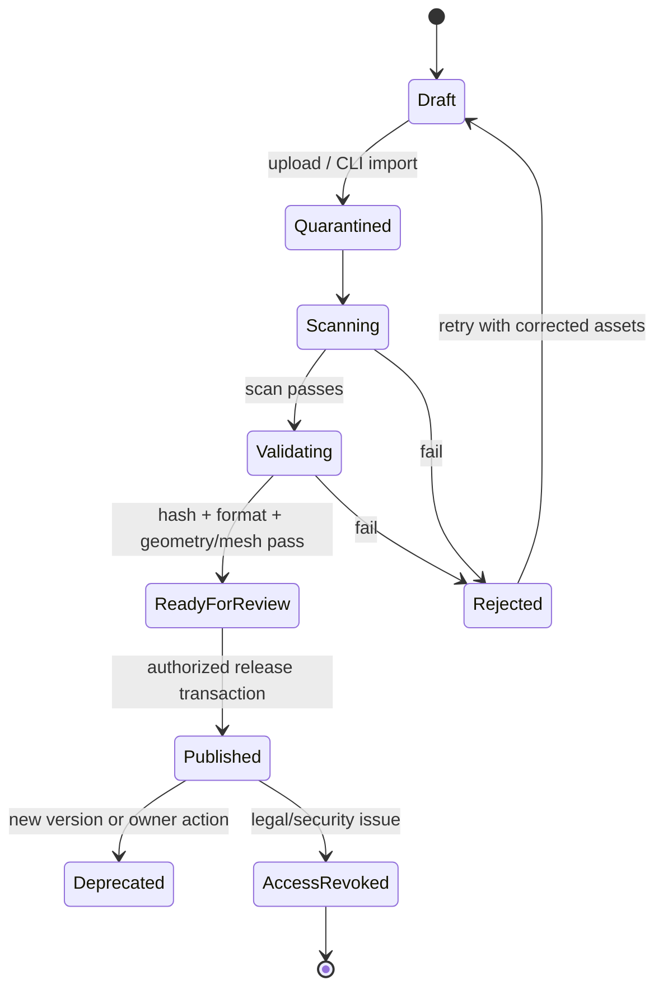

# 23｜P1 Model Library：可复用、可验证的模型资产与发布系统

> P1 目标是**免费或受控模型库/复用中心**，不是付款交易平台。核心路径为：发现→检索→详情→GLB 预览→固定版本引用→权限核验→下载。P1 允许用 CLI 导入已验证 seed 模型，不需要等 P2 Studio 完成。

## 1. 用户故事与非目标

- 访客：能搜“机械”并看到“参数化机械零件”；能在未加载 GLB 时看到模型基本信息；公开模型可下载授权的资源。
- 发布者：能安全上传或通过受控 CLI 导入模型；系统生成 `ModelRelease`，再发布后版本内容不可改变。
- 已授权用户：能从详情页复制 `cad://models/{id}@{version}` 及 manifest hash，下载后 SHA-256 匹配。
- 未授权用户：无法枚举私有内容、绕过 bucket 读取文件，不能通过引用存在性推断私有模型。
- 暂不提供支付、付费分账、复杂社交、模型推荐大模型和编辑/反向恢复 STEP 原生特征史。

## 2. 领域数据与完整性

```text
ModelListing  1 ── N ModelRelease (immutable)
ModelRelease 1 ── N ReleaseAsset (immutable after publish)
ReleaseAsset N ── 1 Asset (content addressed / server verified)
ModelListing N ── N Tag
ModelRelease -> sourceDocumentRevision (optional immutable reference)
```

关键是将 **release 作为聚合根**：发布的 manifest 固定 `assetIds`, `format`, `role`, `sha256`, `bytes`, `units`, `capabilityClass`, `licenseSnapshot`, `sourceRevision`。任何资源变更都应生成新 release，而不是修改当前 release。`release_assets` 的 INSERT/UPDATE/DELETE 应在 publish 完成后被禁止；单纯禁用 `model_releases` UPDATE/DELETE 不够。

建议 `model_releases` 增加 `state = draft|published|deprecated|quarantined`，只有 `published` 时不可修改关联及 manifest；紧急下架**不能改已发布内容**，可以增加 `release_access_overrides` 或独立可审计下架状态记录。不可变不是不可撤销访问权限。

### 能力分级与真实数据保证

| class | 可承诺 | 禁止承诺 |
|---|---|---|
| `MESH_ONLY` | GLB/STL 可视化和网格类导出 | 精确 B-Rep、可修改参数历史 |
| `EXACT_IMPORTED` | 有依据的 STEP B-Rep、尺寸测量与部分精确操作 | 自动恢复原作者建模历史 |
| `PARAMETRIC_NATIVE` | 校验通过的 canonical CAD JSON + 特征 DAG + 固定 kernel/schema 版本 | 不经升级校验就宣称旧版本可以无损重建 |

`Asset` 和 `Listing` 的 class 不应仅由后缀或用户声明决定；release publish validator 必须检查证据和源文件类型。对于没有合法转授权的第三方模型，禁止把它作为公开下载种子数据。

## 3. P1 代码落地建议

```text
apps/api/src/
  http/models.ts                 # public catalog, detail, manifest
  http/assets.ts                 # downloads with ACL
  http/uploads.ts                # signed upload token / local dev
  services/release-service.ts    # publish state machine + DB transaction
  services/access-policy.ts      # public/private/unlisted authorization
  services/asset-validator.ts    # hashing/magic bytes/limits
  db/                             # SQLite repositories and migrations
packages/cad-store/
  schema/                         # DTO, release state and manifest
  migrations/002_release_integrity.sql
  test/release-integrity.test.ts
apps/studio/src/model-gallery/
  SearchPage.tsx / ModelDetail.tsx / GLBViewer.tsx
scripts/
  seed-models.ts                  # controlled seed, non-production sample
  generate-catalog-load.ts       # 10k synthetic records / search benchmark
```

建议先做一个进程内、可在测试环境完整启动的 Node API，不引入微服务。对象存储可本地文件后端 + S3 适配器双实现，但数据授权必须通过同一个 Service。发布后端和上传解析/缩略图构建必须有资源/超时限额；第三方模型不能不经校验直接传给 Web Viewer。

## 4. 发布状态机



不允许 Draft/Quarantined 资源被普通访客下载。发布事务的前置条件包括：sha256 与实际文件一致、解析通过、权限/许可检查完成、manifest hash 计算一致、版本号唯一、所有绑定资源状态已验证。

### 原子发布建议

1. 先将上传的 Blob 存入私有 quarantine key；在独立流程完成类型/大小/哈希/解析检查。
2. 事务内检查 `expectedListingRevision`、资产状态、release 版本唯一与 access policy；记录不可变 manifest 和 membership。
3. DB 事务提交后，发布可访问性；失败清理临时资源或安排 GC 并保留审计日志。
4. 对模型下架使用独立 access flag/事件，不删除历史 release 证据；公开 API 返回明确 unavailable 状态。
5. 下载响应必须经服务端授权，再给短期签名 URL（如使用 S3）；不要把私有永久 object key 直接当可见 URL。

## 5. 中文搜索专项 Spike

当前 SQLite `FTS5 unicode61` 对“参数化机械零件”无法用“机械”召回。P1 应比较：

- `title_exact` / 前缀匹配（精准、低成本，无法解决任意中文词语分割）；
- 预分词后写入独立索引列（中文搜索可控，需保持新增/修改模型索引同步）；
- CJK bigram/ngram 搜索字段（适合子串召回，但要评估误报、索引膨胀）；
- 10k/100k 索引测试后再决定是否采用外部搜索服务；不先引入大型检索平台。

**测试集**：至少 50 个中文搜索查询（长短词、别名、大小写、标点、数字型号）、10k 合成条目、带权真实条目；记录 precision@10、recall@10、p50/p95 latency、索引体积、增量更新开销。先定义期望结果，再选分词实现。

## 6. Viewer 与资源清理

- GLB 预览使用 Three.js 及成熟 glTF loader；相机 orbit、模型 bbox 自动 fit、选择/隐藏、加载进度、错误占位。
- 一切来自资源文件的 geometry/material/texture 与事件监听器需显式释放；多次切换模型不得只替换 `<canvas>` 而遗留 GPU 对象。
- `GLB` 不承载 exact CAD 语义。`openInStudio` 如没有经过 P2 实现，先显示“功能尚未支持”；P1 Gate 不把它作为必要成功动作。
- 上传模型的名称、标签、许可描述均当作不可信文本处理，禁止 HTML 注入和跨站脚本；禁止任意 fetch 用户提供外链。

## 7. REST 边界（P1 最小实现）

| 方法 | Path | 验证/授权 |
|---|---|---|
| GET | `/v1/models?q=&cursor=&format=` | public + authorized listings，稳定游标、排序 |
| GET | `/v1/models/{id}/releases/{version}` | 授权查看 manifest 基本字段 |
| GET | `/v1/models/{id}/releases/{version}/manifest` | 仅对授权用户返回可公开的 asset metadata |
| POST | `/v1/uploads` | 身份、类型、大小预算；签名/本地沙箱 |
| POST | `/v1/models/{id}/releases` | 发布权限、版本唯一、manifest 验证、幂等 |
| GET | `/v1/assets/{assetId}/download` | 单独 `download` ACL，短期 URL / stream |

API 未部署前不要宣称已经形成公开商城。`unlisted` 不是 `public`，必须明确 bearer link 权限与泄露风险，默认无 token 不提供下载。

## 8. G1 测试（自动化）

1. `STORE-SEC-01`：用户 A/B 私有数据隔离，0 个未授权下载成功；403/404 语义按隐私策略。
2. `STORE-IMM-01`：发布后尝试改 `release_assets`、`manifest`、asset sha → 拒绝；新版本成功。
3. `STORE-HASH-01`：下载文件的 hash、bytes、MIME 与 manifest 一致；错误文件不能置为 VALID。
4. `STORE-FTS-01`：中文“机械”可找到“参数化机械零件”；包含负例，测召回/误报。
5. `STORE-VIEW-01`：20 个 GLB/损坏文件切换、加载/卸载 GPU 资源，无旧模型残影。
6. `STORE-LOAD-01`：10k 合成模型固定设备 p95 搜索目标 ≤ 300 ms，记录 SQL 查询与数据集种子。
7. `STORE-FLOW-01`：搜索→详情→版本→预览→复制 immutable ref→下载→hash 校验，浏览器 E2E 全部通过。

**P1 完成与否只由上述证据决定**，不以页面有多少卡片或目录文件数判断。
