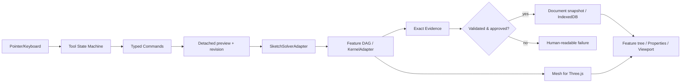
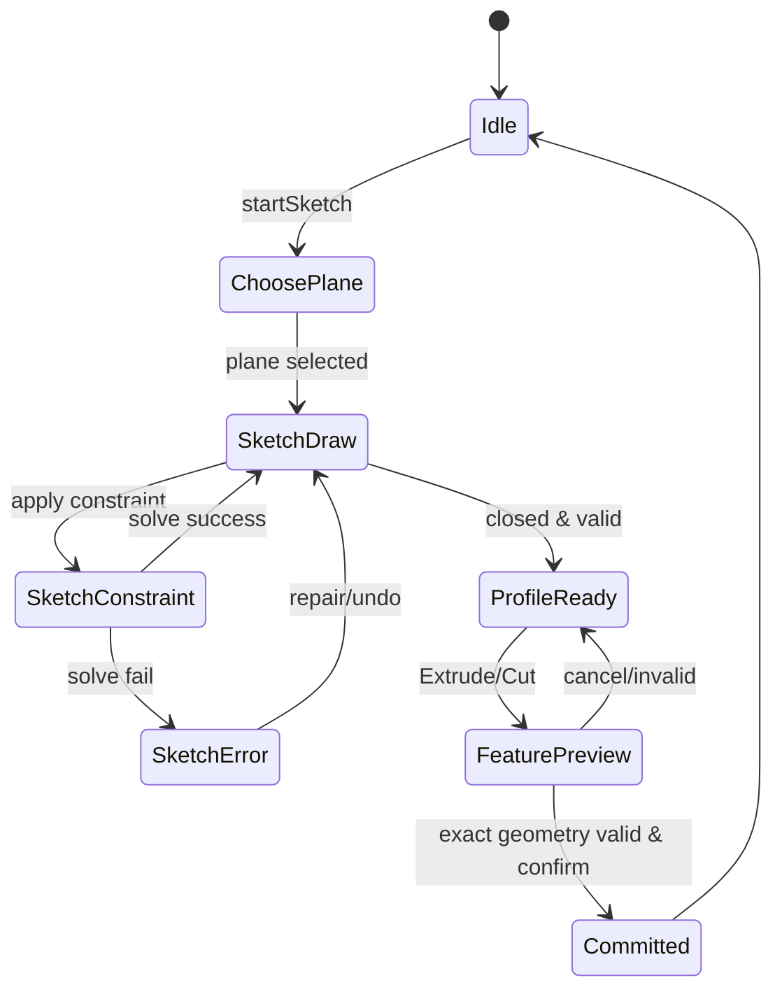

# 24｜P2 Parametric Studio：从草图约束到真实 STEP 的垂直产品切片

> **目标用户**：有基础尺寸设计需求的个人/小团队。**范围**：单零件、单 Body、2D 草图的基础约束、拉伸和孔切除、参数修改、保存与可追溯导出。尚不覆盖通用装配、多体、曲面建模、工程图、复杂圆角或生产 MCP。

## 1. 不以 Three.js Mesh 为设计文档

工作台读取 `CadDocumentV1`，修改只能经 `CommandEngine`，从 `KernelAdapter` 获得 B-Rep 的真实几何 evidence 和 tessellation，Three.js 只消费可视化数据。参数历史、草图实体和引用存入 Canonical Document，不存 GPU 三角面作为唯一真相。



## 2. 2D 草图的最小实体契约

- `Point`: stable `entityId`, `(xMm, yMm)`、construction flag。
- `LineSegment`: stable ID, `startPointId`, `endPointId`，禁止零长度。
- `Circle`: stable ID, center point ID、radiusMm 或正确定义的参数引用。
- `Rect`: UI 工具，不作为求解器的黑盒几何类型；提交时展开为 4 条边和关联点。
- `Arc`: P2 可放在后半程；若影响核心闭环则暂不进入 G2 必选项。
- 约束至少：coincident、horizontal、vertical、distance、radius、perpendicular、fixed；parallel、tangent、equal 作为扩展。
- 约束实体必须引用现存草图 ID；临时拖动约束与永久设计约束分离。

`SketchSolveResult`：`status` (`underconstrained|fullyconstrained|overconstrained|inconsistent|diverged`)，`updatedGeometry`、`residuals`、`conflictingConstraintIds`（若求解器可提供）、`solverVersion`。不可准确获得自由度时不得伪报 `dof=0`。

## 3. UI 工具状态机



- `Esc`：第 1 次取消当前命令预览，不撤销已提交历史；第二次回到 idle，焦点有明确路径。
- `Undo/Redo`：对明确提交的 Typed Command/Snapshot；禁用时给出可解释状态。
- 鼠标移动过程中显示快速预览，只有 Worker 精确建模和证据通过后可 Commit。
- `generation` 单调递增；过期结果丢弃并释放，不修改已保存快照。

## 4. Feature & Parameter 系统

| 子模块 | P2 必做行为 | 异常路径 |
|---|---|---|
| Sketch Engine | 计算平面闭合轮廓，支持最小图元与尺寸约束 | 自交、重复点、未闭合、约束冲突 |
| Feature Builder | `extrude`（形成实体）、`boolean.cut`（开孔），有限的 `union` | 零厚度、没有交集、方向/单位错误 |
| Feature DAG | `parameter.set` 查依赖、增量重建并保持旧有效版本 | 循环、缺失引用、某节点失败 |
| Body Selection | 三维拾取返回 Body/Face/Edge 可识别引用 | 非唯一或失效拓扑引用 fail-closed |
| Revision / Recovery | IndexedDB 存 canonical doc、version、校验 hash | 中断写入、旧 schema、文档不兼容 |
| STEP | 使用 P0 通过的单零件导出能力 | 真实重导入失败则禁止声称成功 |

### 重点：拓扑引用问题

`faceIndex=3` 不可作为跨重建的稳定引用。P2 最小实现可以采用创建特征来源 + 几何签名 + 候选唯一性；若不唯一，提示重新选择并阻断下游有风险操作。暂不承诺“任意修改参数后所有面引用仍能稳定保留”。

### 增量重建示例

`holeDiameter` 参数 → 圆孔草图 → 切割工具体 → `cut` 结果。改 8→12 时，无需重建不相关的板材基体；但必须更新所有依赖孔径的下游特征。体积由 `216000 − πr²×30` 预期公式验证：8 mm 对应 `214492.0355... mm³`，12 mm 对应 `212607.079934... mm³`。这只是本 fixture 的理论值，实际证据必须由 OCCT 计算。

## 5. Local-first 保存策略

- 每次有效 commit 写入不可变 revision snapshot、document hash、kernel version、timestamp；先写入新记录，再以事务方式更新 `currentRevision` 指针。
- 区分 `draft`（未验证操作）和 `committed revision`（有几何证据），刷新只恢复最新完整提交；遇到不兼容版本应保留原始数据并提示导出。
- Worker 产生的 mesh 缓存可重建且可丢弃；不要把缓存丢失当成 CAD 文档损坏。
- 对同一文档多标签页修改，可先锁定单写者并提示冲突；不进行静默最后写入者覆盖。

## 6. P2 最小页面与职责

```text
apps/studio/src/
  workspace/WorkspaceShell.tsx   # Ribbon / FeatureTree / Properties / Status
  tools/ToolController.ts        # strict state machine
  sketch/SketchCanvas.tsx        # 2D interaction and snapping
  sketch/SketchSolverAdapter.ts  # planegcs behind stable schema
  viewport/CadViewport.tsx      # B-Rep-derived mesh selection
  commands/useCadCommands.ts     # typed preview + revision control
  storage/LocalDocumentStore.ts  # IndexedDB snapshots / migrations
  export/StepExport.ts           # exact body -> STEP + read-back evidence
  testing/fixtures.ts            # deterministic E2E docs
```

P2 工作台和 P1 Gallery 应复用的组件：`CadModelViewer`、`ModelCapabilityBadge`、`GeometryErrorPanel`、`Loading/JobState`、`AssetManifest`；不要将权限与几何直接塞进 React 组件。

## 7. G2 必须跑通的浏览器回放

1. 新建 `doc_demo`，选择 `XY`，使用精确坐标绘制 120×60 矩形。
2. 加上水平/垂直/重合/尺寸约束，求解器报告完全约束或列出剩余自由度。
3. 以 30 mm 厚度 extrude，产生**精确**且有效的 1 个 Solid。
4. 在板中心添加直径 8 mm 的圆及约束，切割贯通，体积与理论值在 fixture 容差内。
5. `parameter.set(holeDiameter, 12 mm)`，自动重建，体积/相关 mesh 变更，旧 generation 不再显示。
6. Undo/Redo 后几何、revision、document hash 与预期一致；页面刷新/重新打开后也一致。
7. 导出 STEP，使用新的 Reader 重新导入，再核验 1 个有效实体、volume/bbox 及文件的 sha256；上传到 P1 Gallery 时可标注 `PARAMETRIC_NATIVE`（仅在满足许可与格式验证后）。
8. 模拟异常：未闭合 profile、约束冲突、错误半径、过期 Worker 回包、IndexedDB 写入中断；原文档完整无损。

## 8. DoD / 非完成定义

完成需要自动化浏览器回放、可重复几何 evidence、可保存/恢复的特征树、不可越过的失败门禁，并附 CI、运行平台和浏览器版本。仅能旋转 STL/GLB、修改三角网格顶点、加载一份之前生成的 STEP、拖动参数滑块改变显示尺寸、或者后台 Python 单测通过，均不能宣称 P2 完成。
